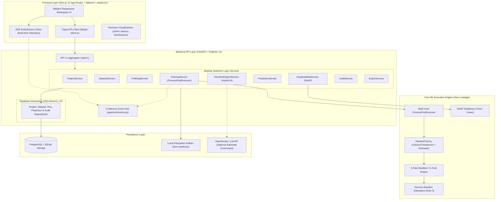

# AutoMLens — Human-Assisted AutoML Platform for Tabular Data

[](https://www.python.org/)
[](https://fastapi.tiangolo.com/)
[-black.svg)](https://nextjs.org/)
[](https://www.typescriptlang.org/)
[](https://scikit-learn.org/)
[](https://shap.readthedocs.io/)
[]()
[]()

> **B.Tech Final-Year Minor Project** (October–December 2026)  
> **Author & Solo Developer:** Pratham Petwal  
> **Project Repository:** [https://github.com/pratham9634/Automlens.git](https://github.com/pratham9634/Automlens.git)

---

## 📖 Executive Summary

Most automated machine learning (AutoML) frameworks operate as opaque black boxes: they fit preprocessing steps across the entire dataset prior to cross-validation (introducing severe **data leakage**), train complex black-box models without evaluating whether they beat simple heuristic baselines, fail to explain their engineering decisions, and lack verifiable audit trails.

**AutoMLens** is an academically rigorous, human-in-the-loop AutoML platform engineered specifically for tabular data. It guarantees mathematical correctness across the entire machine learning lifecycle:
1. **Zero Data Leakage:** All imputation, encoding, and scaling operations are encapsulated inside `sklearn.Pipeline` objects and fitted strictly within each cross-validation fold.
2. **Human Target Confirmation:** Task detection is treated strictly as an expert suggestion; human confirmation is required prior to training.
3. **Mandatory Baseline Benchmark:** Every model leaderboard is measured against a deterministic Dummy Baseline (`DummyClassifier` / `DummyRegressor`).
4. **Hybrid AI Decision System:** Deterministic heuristic rules provide 100% offline, reproducible algorithm selection, enriched optionally with human-readable LLM reasoning via OpenRouter.
5. **Game-Theoretic Explainability:** Local and global model interpretability using SHAP (`TreeExplainer` & `LinearExplainer`) with academic causation disclaimers.
6. **Immutable Audit Ledger:** Every transformation, training event, and prediction is timestamped and recorded in an audit trail for viva defense and compliance.

---

## 🏛️ System Architecture



---

## ⚖️ ML Correctness Rules (Academic Compliance Matrix)

AutoMLens is built upon 10 non-negotiable correctness principles required for academic credibility:

| # | Rule Principle | Academic Rationale | Implementation in AutoMLens |
|---|----------------|--------------------|-----------------------------|
| **1** | **Zero Data Leakage** | Fitting transformers (imputers, scalers, encoders) on full data causes optimistic bias. | All preprocessing encapsulated in `sklearn.compose.ColumnTransformer` inside `Pipeline`. Transformations fit **strictly inside each CV fold**. |
| **2** | **Explicit Target Confirmation** | Automated target guessing is error-prone and can violate user intent. | Task detection provides suggestions; human confirmation (`POST /api/v1/projects/{id}/target/confirm`) is mandatory before training can start. |
| **3** | **5-Fold Cross-Validation** | Single train-test splits produce high variance on tabular datasets. | `StratifiedKFold(n_splits=5)` for classification; `KFold(n_splits=5)` for regression. Dynamic fold reduction if minority class count < 5. |
| **4** | **Mandatory Dummy Baseline** | Real models must be proven to learn beyond trivial majority class or mean predictions. | `DummyClassifier(strategy='most_frequent')` or `DummyRegressor(strategy='mean')` automatically evaluated and pinned on the leaderboard. |
| **5** | **Deterministic Reproducibility** | Experiments must be 100% reproducible for viva examination. | Fixed random seeds (default `42`), fold-by-fold score preservation, dataset SHA-256 fingerprinting, and run manifests saved to disk. |
| **6** | **Outlier Reporting Without Auto-Removal** | Removing valid extreme observations can distort distribution and discard valuable signals. | Outliers detected via IQR (Tukey's method) and reported in data profile. Robust scaling (`RobustScaler`) is used without dropping rows. |
| **7** | **Zero Metric Fabrication** | Simulating or fabricating performance undermines scientific integrity. | All metrics computed empirically via scikit-learn. If a worker process fails, the exact stack trace is surfaced and audited. |
| **8** | **Full Pipeline Persistence** | Scoring models must replicate identical training transformations on unseen data. | The complete fitted `Pipeline` (preprocessing + estimator) is persisted as `.joblib` on disk and exported for production inference. |
| **9** | **Strict Nomenclature & Attribution** | Ambiguous labels mislead stakeholders regarding metric and explainer semantics. | Explicit labels used everywhere: *"F1 Score (macro)"*, *"Mean \|SHAP\| via TreeExplainer on 100 background samples"*. |
| **10** | **Academic Causation Disclaimer** | Machine learning correlation does not imply real-world causation. | Every SHAP visualization and export includes the mandatory disclaimer: *"Feature attribution explains model behavior, not causation."* |

---

## ⚡ Core Features & Capabilities

### 1. Automated Statistical Data Profiling & Quality Engine
- Computes distribution summaries (mean, std, min, max, quartiles, skewness, kurtosis).
- Tukey IQR outlier detection and duplicate row identification.
- Cardinality analysis and missingness detection per column.
- Pairwise Pearson correlation matrix with automated high-correlation flagging ($\ge 0.85$).
- Overall **Dataset Health Quality Score** (0–100 scale).

### 2. Hybrid AI Decision Engine
- **Deterministic Heuristic Rules:** Analyzes row count, feature count, missingness, cardinality, and target distribution to select optimal candidate models and preprocessing plans. 100% reproducible and functions completely offline.
- **LLM Rationale Enrichment:** When `OPENROUTER_API_KEY` is configured, queries OpenRouter (default: Llama 3.3 70B Instruct) to generate plain-English engineering justifications for examiners. Seamlessly falls back to deterministic rule summaries when offline.

### 3. Parallel Multi-Core Cross-Validation
- Multi-process worker pool (`concurrent.futures.ProcessPoolExecutor`) distributes model training across available CPU cores.
- Computes macro-averaged metrics (Accuracy, F1 Macro, Precision Macro, Recall Macro, ROC-AUC for classification; $R^2$, RMSE, MAE for regression) with mean and standard deviation across folds.

### 4. Real-Time Telemetry Console (SSE)
- Non-polling Server-Sent Events (`StreamingResponse` / `EventSource`) broadcast real-time training progress, fold completions, and model scores to the frontend.

### 5. Single & Batch Inference
- **Interactive Single-Row Prediction:** Real-time form with probability breakdown and prediction confidence.
- **High-Throughput Batch Scoring:** Upload unseen CSV files to generate predictions, preview results, and download scored CSV files.
- **Confusion Matrix:** Full $N \times N$ matrix with per-class precision and recall.

### 6. Game-Theoretic Explainability (SHAP XAI)
- **Global Feature Importance:** Top features ranked by Mean $|SHAP|$ attribution using `TreeExplainer` or `LinearExplainer` on a representative background distribution.
- **Local Waterfall Attributions:** Single-observation waterfall breakdown revealing which specific features pushed the prediction positive or negative.
- Plain-English layman summaries and mandatory academic causation disclaimers.

### 7. Immutable Audit Ledger
- Cryptographically sound, persistent chronological audit trail (`AuditEvent`).
- Tracks: `project_created`, `dataset_uploaded`, `profile_generated`, `target_confirmed`, `training_started`, `training_completed`, `prediction_single`, `prediction_batch`, `explanation_global`, `explanation_local`, and `export_downloaded`.
- Captures engineering rationale, empirical evidence, timestamps, and execution outcomes.

### 8. Reproducibility Artifact Hub
Provides one-click downloads for 6 standardized reproducibility artifacts:
1. `quality_report.json` — Complete statistical profile and data health assessment.
2. `leaderboard.csv` — Full model leaderboard with fold scores, training durations, and baseline indicators.
3. `predictions.csv` — Logged single and batch inferences with probability outputs.
4. `run_manifest.json` — Environment manifest with library versions, random seeds, and dataset fingerprints.
5. `pipeline.joblib` — Complete fitted scikit-learn Pipeline (preprocessing + model).
6. `audit_ledger.json` — Full chronological event ledger with SHA-256 integrity checksums.

---

## 🛠️ Technology Stack

```
AutoMLens
├── Frontend
│   ├── Framework: Next.js 14+ (App Router)
│   ├── Language: TypeScript (Strict Mode)
│   ├── Styling: Tailwind CSS
│   ├── Components: Radix UI / shadcn/ui
│   ├── Charts: Recharts
│   └── Real-Time: Server-Sent Events (SSE) EventSource
│
├── Backend
│   ├── Framework: FastAPI 0.110+
│   ├── Language: Python 3.11+
│   ├── Validation: Pydantic v2
│   ├── Concurrency: ProcessPoolExecutor + BackgroundTasks
│   ├── Database: PostgreSQL via SQLAlchemy 2.0 (SQLite for tests)
│   ├── Code Quality: Ruff (100-char line limit, strict rules)
│   └── Testing: pytest + httpx (53 automated tests)
│
└── Machine Learning & AI
    ├── Core ML: scikit-learn (Pipelines, ColumnTransformer, StratifiedKFold)
    ├── Data: Pandas, NumPy
    ├── Explainability: SHAP (TreeExplainer, LinearExplainer)
    ├── Serialization: joblib
    └── Hybrid AI: Deterministic Rule Engine + OpenRouter LLM API
```

---

## 🚀 Getting Started (Local Setup)

### Prerequisites
- **Python 3.11+** installed
- **Node.js 18+** & **npm** installed
- (Optional) **Docker Desktop** for local PostgreSQL (or uses built-in SQLite)

### 1. Clone Repository & Setup Branches
```bash
git clone https://github.com/pratham9634/Automlens.git
cd Automlens
git checkout develop
```

### 2. Backend Setup
```bash
cd backend

# Create and activate virtual environment
python -m venv venv
# On Windows:
.\venv\Scripts\activate
# On Linux/macOS:
# source venv/bin/activate

# Install dependencies
pip install -r requirements.txt

# Configure Environment Variables
cp .env.example .env
# Optional: Set OPENROUTER_API_KEY in .env for LLM enrichment (works 100% offline without it)

# Run Backend Server
python -m uvicorn app.main:app --reload --port 8000
```
Backend will be live at: `http://localhost:8000`  
Interactive Swagger API docs at: `http://localhost:8000/docs`

### 3. Frontend Setup
```bash
cd ../frontend

# Install dependencies
npm install

# Run Development Server
npm run dev
```
Frontend will be live at: `http://localhost:3000`

---

## 🧪 Automated Test Suite Verification

AutoMLens includes a comprehensive 53-test automated test suite verifying every component from unit functions to full end-to-end user workflows:

```bash
# Run complete test suite in backend
cd backend
python -m pytest

# Run Ruff linter
python -m ruff check .

# Verify frontend types and ESLint
cd ../frontend
npx tsc --noEmit
npm run lint
```

### Test Coverage Highlights
- **`test_e2e_workflow.py`:** End-to-end lifecycles for Titanic classification, California Housing regression, and edge-case validation safeguards.
- **`test_training.py`:** Zero-leakage pipeline execution, 5-fold cross-validation, and Dummy Baseline Rule 4 compliance.
- **`test_decision_engine.py`:** Deterministic candidate selection, task detection, and hybrid fallback behavior.
- **`test_explainability.py`:** TreeExplainer and LinearExplainer SHAP attribution and Rule 10 causation disclaimer enforcement.
- **`test_audit.py` & `test_exports.py`:** Immutable audit ledger recording and 6-artifact export generation.

---

## 🎓 Viva Defense Presentation Script & Demo Guide

Use this structured walkthrough during the final-year B.Tech minor project defense:

### 1. Introduction & The Core Problem (Slide 1–2 / 2 Mins)
> *"Examiners, standard AutoML platforms act as black boxes. They frequently commit the cardinal sin of machine learning: data leakage. Preprocessing operations like scaling and target encoding are often fit on the entire dataset before splitting, leading to optimistically biased metrics. Furthermore, they don't explain why models were chosen or evaluate whether they beat naive baselines. AutoMLens solves this with human-assisted, mathematically sound AutoML."*

### 2. One-Click Benchmark Load & Statistical Profiling (Demo Screen 1)
- Navigate to `http://localhost:3000`.
- Click **"New Project"** -> Name it `"Titanic Survivor Classifier"`.
- Click the 1-Click Benchmark button: **"Titanic Survival"**.
- Point out the instant preview of rows, column types, and SHA-256 fingerprint.
- Navigate to **"Data Profiling"**:
  - Show the **Dataset Quality Score**.
  - Highlight the **Outlier Report** (e.g., high fares) and explain **Rule 6**: *"Notice we flag outliers and switch to robust scaling, but we never automatically drop them without human consent."*
  - Show the **Correlation Matrix** identifying feature relationships.

### 3. Human Target Selection & Hybrid AI Decision Engine (Demo Screen 2)
- Navigate to **"Model Training"**.
- Show that the target is pre-analyzed as `survived` (`binary_classification`).
- Highlight **Rule 2**: *"Notice that training cannot proceed until the human engineer explicitly confirms the target and candidate models."*
- Click **"Generate AI Strategy Rationale"**: Show the deterministic rule engine selecting Logistic Regression, Random Forest, and HistGradientBoosting alongside the mandatory **Dummy Classifier** (Rule 4).

### 4. Parallel Multi-Core Training & Real-Time Telemetry (Demo Screen 3)
- Click **"Launch Parallel Training"**.
- Show the real-time **SSE Telemetry Console** streaming live fold completions across CPU cores.
- Explain **Rule 1 & Rule 3**: *"Each worker receives its fold indices and constructs an independent scikit-learn Pipeline. Preprocessing is strictly fit on fold training data—ensuring absolute zero leakage."*

### 5. Leaderboard & Dummy Baseline Proof (Demo Screen 4)
- View the **Leaderboard**:
  - Point out that all models are ranked by **F1 Score (macro)** with standard deviation across folds (e.g., $0.81 \pm 0.02$).
  - Point out the **Dummy Classifier (Baseline)** row: *"Here is our scientific proof: Random Forest achieved 0.81 macro F1, soundly beating the baseline's 0.35 majority class score."*

### 6. Interactive Single & Batch Predictions (Demo Screen 5)
- Navigate to **"Predict"**:
  - Perform a single prediction: Input a 1st-class female passenger -> Model predicts **Survived** with high confidence.
  - Upload `data/demo/batch_predict_sample.csv` (50 unseen passengers) -> High-throughput batch scoring produces immediate preview rows and a downloadable CSV.
  - Inspect the **Confusion Matrix** showing true vs. predicted counts and per-class recall.

### 7. Game-Theoretic SHAP Explainability (Demo Screen 6)
- Navigate to **"Explanations"**:
  - Show **Global Feature Importance**: Top features ranked by Mean $|SHAP|$ (e.g., `sex`, `pclass`, `fare`).
  - Show **Local Waterfall Attribution**: Reveals exactly which passenger attributes contributed to their survival score.
  - Highlight **Rule 10**: Point out the academic disclaimer banner at the bottom of the screen: *"Feature attribution explains model behavior, not real-world causation."*

### 8. Audit Ledger & Reproducibility Hub (Demo Screen 7)
- Navigate to **"Audit Timeline"**:
  - Show the immutable chronological trail: Every action from dataset upload to prediction has a recorded engineering reason and empirical evidence.
- Navigate to **"Export Hub"**:
  - Download the `manifest.json` and `pipeline.joblib`.
  - Conclude: *"Examiners, every artifact required to independently reproduce this experiment is hashed with SHA-256 and downloadable for peer review."*

---

## 📁 Repository Structure

```
Automlens/
├── backend/
│   ├── app/
│   │   ├── api/v1/                   # FastAPI route handlers & Pydantic schemas
│   │   ├── core/                     # Configuration, structured logging, errors, SSE
│   │   ├── db/                       # SQLAlchemy models & repositories
│   │   ├── ml/                       # PipelineFactory, task detection, metrics
│   │   ├── services/                 # Business logic services
│   │   └── storage/                  # Local filesystem storage abstraction
│   ├── tests/                        # 53 pytest integration & unit tests
│   ├── pyproject.toml                # Ruff configuration
│   └── requirements.txt              # Backend dependencies
│
├── frontend/
│   ├── app/                          # Next.js 14 App Router pages & layouts
│   ├── components/                   # Modular shadcn/ui & custom UI components
│   ├── lib/                          # Typed API client, TypeScript definitions
│   └── package.json                  # Frontend dependencies
│
├── data/
│   └── demo/                         # Built-in benchmark datasets (Titanic, Housing, Batch)
├── artifacts/                        # Runtime generated models, profiles, exports (gitignored)
└── README.md                         # Project documentation & presentation guide
```

---

## 📜 Git Branch Hierarchy & Workflow

This project strictly adheres to professional git conventions:
- **`main`**: Production release branch. Only stable, fully tested releases are merged here.
- **`develop`**: Active development and integration branch.
- **`feature/<name>`**: Feature branches branched from and merged back into `develop`.

*Direct commits to `main` are strictly prohibited.*

---

## 👤 Author & Acknowledgments

- **Pratham Petwal** — Developer, Machine Learning Engineering, System Architecture.
- B.Tech Computer Science & Engineering (Final-Year Minor Project, 2026).
