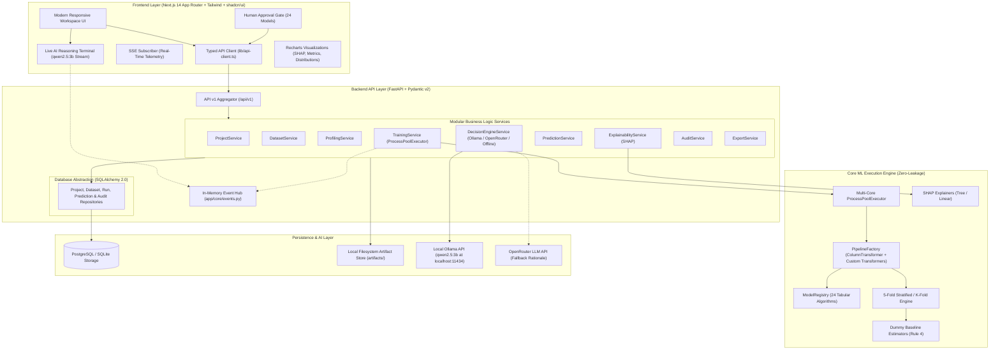

# AutoMLens — Human-Assisted AutoML Platform for Tabular Data

[](https://www.python.org/)
[](https://fastapi.tiangolo.com/)
[-black.svg)](https://nextjs.org/)
[](https://www.typescriptlang.org/)
[](https://scikit-learn.org/)
[-purple.svg)](https://ollama.ai/)
[](https://shap.readthedocs.io/)
[]()
[]()

> **B.Tech Final-Year Minor Project** (October–December 2026)  
> **Author & Solo Developer:** Pratham Petwal  
> **Project Repository:** [https://github.com/pratham9634/Automlens.git](https://github.com/pratham9634/Automlens.git)

---

## 📖 Executive Summary

Most automated machine learning (AutoML) frameworks operate as opaque black boxes: they fit preprocessing steps across the entire dataset prior to cross-validation (introducing severe **data leakage**), train complex black-box models without evaluating whether they beat simple heuristic baselines, fail to explain their engineering decisions, and lack verifiable audit trails.

**AutoMLens** is an academically rigorous, human-in-the-loop AutoML platform engineered specifically for tabular data. It guarantees mathematical correctness across the entire machine learning lifecycle:
1. **Zero Data Leakage:** All imputation, encoding, scaling, custom feature extractions, and dimensionality reduction are encapsulated inside `sklearn.Pipeline` objects and fitted strictly within each cross-validation fold.
2. **Intent-Guided AI & Real-Time Reasoning:** Users can specify a natural language modeling goal. A local Ollama instance running **`qwen2.5:3b`** streams its step-by-step reasoning tokens live over Server-Sent Events (SSE).
3. **Automated Feature Extraction & Cleaning:** Automated temporal date decomposition (`DateTimeFeatureExtractor`), numeric interaction ratios (`InteractionFeatureExtractor`), and outlier winsorization (`OutlierCapper`).
4. **Comprehensive 24-Model Suite:** Evaluates up to 24 diverse algorithms across linear models, tree ensembles, gradient boosting, support vector machines, nearest neighbors, and neural networks.
5. **Interactive Human Approval Gate:** Prepares all preprocessing and model recommendations autonomously, pausing at a single-click checkpoint where humans can review, add extra models, or modify evaluation metrics before training.
6. **Mandatory Baseline Benchmark:** Every model leaderboard is measured against a deterministic Dummy Baseline (`DummyClassifier` / `DummyRegressor`) to mathematically prove empirical learning (Rule 4).
7. **Game-Theoretic Explainability:** Local and global model interpretability using SHAP (`TreeExplainer` & `LinearExplainer`) with academic causation disclaimers.
8. **Immutable Audit Ledger:** Every transformation, training event, and prediction is timestamped and recorded in an audit trail for viva defense and compliance.

---

## 🏛️ System Architecture



---

## ⚡ Core Features & Capabilities

### 1. Intent-Guided AI Modeling & Live Streaming Terminal
- **Natural Language Objective Guidance:** Users can specify modeling goals (e.g., *"Predict customer churn risk and extract tenure from signup date"*).
- **Live AI Reasoning Terminal:** Real-time token streaming from local **`qwen2.5:3b`** via Server-Sent Events (SSE). Users watch the AI analyze metadata, distributions, and formulate feature extraction steps live.
- **Resilient Offline Fallback:** If Ollama is offline, automatically switches to the deterministic heuristic rule engine without throwing errors.

### 2. Zero-Intervention Automated Feature Extraction (Rule 1)
- **`DateTimeFeatureExtractor`:** Automatically detects datetime columns and extracts calendar components (`year`, `month`, `day`, `dayofweek`, `is_weekend`) with fold-safe imputation.
- **`InteractionFeatureExtractor`:** Computes numeric ratios, products, and differences with robust zero-division protection.
- **`OutlierCapper`:** Learns Tukey IQR bounds strictly on training folds and winsorizes values during transformation.
- **Dynamic Dimensionality Reduction:** Automatic `PCA` / `SelectKBest` integration when feature count is high ($P > 30$ or $P > N$).

### 3. Expanded 24-Model Algorithm Catalog
- **Classification (12):** Dummy Classifier (Rule 4 Baseline), Logistic Regression, Ridge Classifier, Random Forest, Extra Trees, HistGradientBoosting, LightGBM, XGBoost, Linear SVC (Calibrated), K-Nearest Neighbors, MLP Neural Network, AdaBoost.
- **Regression (12):** Dummy Regressor (Rule 4 Baseline), Ridge, Lasso, ElasticNet, Random Forest, Extra Trees, HistGradientBoosting, LightGBM, XGBoost, Linear SVR, K-Nearest Neighbors, MLP Regressor.

### 4. Interactive Human Approval Gate
- Automates data cleaning, scaling, feature extraction, and algorithm recommendations with zero human effort.
- Pauses at an approval threshold: users inspect the AI's blueprint, check/uncheck any of the 24 models, adjust metrics, and click **"Approve & Launch Model Training"**.

### 5. Parallel Multi-Core 5-Fold Cross-Validation
- Multi-process worker pool (`ProcessPoolExecutor`) distributes model training across CPU cores.
- Evaluates macro-averaged metrics (Accuracy, F1 Macro, Precision Macro, Recall Macro, ROC-AUC for classification; $R^2$, RMSE, MAE for regression) with mean and standard deviation across folds.

### 6. Game-Theoretic Explainability (SHAP XAI)
- **Global Feature Importance:** Top features ranked by Mean $|SHAP|$ attribution using `TreeExplainer` or `LinearExplainer`.
- **Local Waterfall Attributions:** Single-observation waterfall breakdown revealing which features influenced the prediction.
- Academic disclaimer banner: *"Feature attribution explains model behavior, not causation."*

### 7. Immutable Audit Ledger & Reproducibility Hub
- Persistent chronological audit trail (`AuditEvent`) with SHA-256 integrity checksums.
- Downloadable artifacts: `quality_report.json`, `leaderboard.csv`, `predictions.csv`, `run_manifest.json`, `pipeline.joblib`, and `audit_ledger.json`.

---

## 🛠️ Technology Stack

```
AutoMLens
├── Frontend
│   ├── Framework: Next.js 14+ (App Router)
│   ├── Language: TypeScript (Strict Mode)
│   ├── Styling: Tailwind CSS
│   ├── Components: Radix UI / shadcn/ui
│   ├── Charts: Recharts
│   └── Real-Time: Server-Sent Events (SSE) EventSource & ReadableStream
│
├── Backend
│   ├── Framework: FastAPI 0.111+
│   ├── Language: Python 3.11+
│   ├── Validation: Pydantic v2
│   ├── Concurrency: ProcessPoolExecutor + BackgroundTasks
│   ├── Database: PostgreSQL via SQLAlchemy 2.0 (SQLite for tests)
│   ├── Code Quality: Ruff (100-char line limit, strict rules)
│   └── Testing: pytest + httpx (66 automated tests)
│
└── Machine Learning & AI
    ├── Core ML: scikit-learn (Pipelines, ColumnTransformer, StratifiedKFold)
    ├── Boosters: XGBoost, LightGBM
    ├── Custom Transformers: DateTimeFeatureExtractor, InteractionFeatureExtractor, OutlierCapper
    ├── Model Registry: 24 Tabular Models (Classification & Regression)
    ├── Local AI: Ollama (qwen2.5:3b) via OpenAI SDK (AsyncOpenAI)
    ├── Explainability: SHAP (TreeExplainer, LinearExplainer)
    └── Serialization: joblib
```

---

## 🚀 Getting Started (Local Setup)

### Prerequisites
- **Python 3.11+**
- **Node.js 18+** & **npm**
- **Ollama** installed with `qwen2.5:3b` pulled:
  ```bash
  ollama pull qwen2.5:3b
  ollama serve
  ```

### 1. Backend Setup
```bash
cd backend
python -m venv venv
.\venv\Scripts\activate   # Windows

pip install -r requirements.txt
cp .env.example .env

# Run Backend
python -m uvicorn app.main:app --reload --port 8000
```
Backend API will be live at `http://localhost:8000` (Swagger docs: `http://localhost:8000/docs`).

### 2. Frontend Setup
```bash
cd frontend
npm install
npm run dev
```
Frontend will be live at `http://localhost:3000`.

---

## 🧪 Automated Test Suite Verification

AutoMLens includes **66 automated tests** verifying every component from custom transformers to full end-to-end workflows:

```bash
# Run complete test suite in backend
cd backend
python -m pytest

# Run Ruff linter
python -m ruff check .

# Verify frontend types, ESLint, and production build
cd ../frontend
npx tsc --noEmit
npm run lint
npm run build
```

---

## 👤 Author & Acknowledgments

- **Pratham Petwal** — Developer, Machine Learning Engineering, System Architecture.
- B.Tech Computer Science & Engineering (Final-Year Minor Project, 2026).
